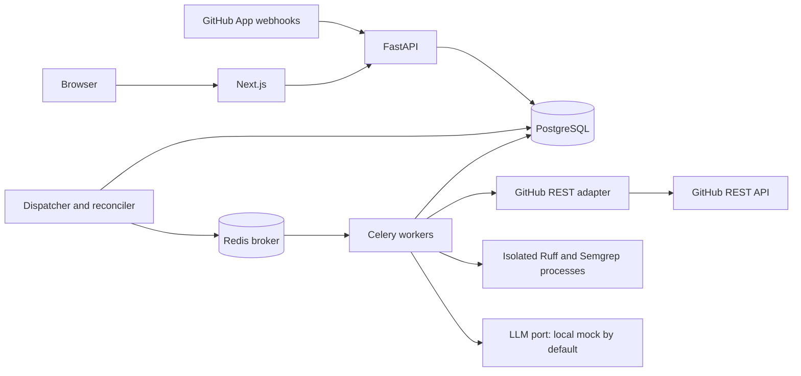

# Shrike architecture

Status: living architecture, 2026-11-06. Phases 2-7 implement scoped persistence, GitHub ingestion, standalone analysis, asynchronous review execution, independent advisory publication and the authenticated dashboard. Production hardening/cloud remain proposed. GitHub/AI verification uses mocks; Redis/Celery, PostgreSQL and isolated Ruff run locally. Product scope and limits live in [PRD.md](PRD.md); phase gates live in [ROADMAP.md](ROADMAP.md).

Project identity: **Shrike**, canonical repository `https://github.com/allenuh/shrike.git`. Existing Python packages, API branding, Compose service/data names, and fixtures already use this identity; no runtime rename or data migration is required.

## Implemented Phase 2 baseline

The user explicitly redefined Phase 2 as persistence and core backend APIs. [ADR 0001](adr/0001-persistence-phase-scope.md) records the scope, naming/state decisions, security tradeoffs, and prerequisite setup. The implemented surface consists of a uv Python workspace, shared SQLAlchemy persistence package, FastAPI read API, six-table Alembic migration, synthetic CLI seed, database-only Compose service, and disposable PostgreSQL tests. It includes no live GitHub/LLM calls, webhook routes, worker pipeline, frontend, or cloud resources.

Current tables are `installations`, `repositories`, `pull_requests`, `review_jobs`, `review_findings`, and `review_executions`. Public job states are `pending`, `running`, `completed`, `failed`, and `canceled`. Composite foreign keys enforce job installation/repository/PR ownership, and unique analysis identities include both SHAs and policy digest. Execution attempts and finding fingerprints are unique within each job. Check constraints enforce IDs, enums, timestamps, line/path validity, and nonnegative usage. Internal worker identifiers and policy/fingerprint columns do not enter public read models.

Current routes are `/health/live`, `/health/ready`, `/v1/repositories`, `/v1/repositories/{id}`, `/v1/review-jobs`, `/v1/review-jobs/{id}`, and `/v1/review-jobs/{id}/findings`. List reads use bounded keyset pagination and filter/scope-bound cursors. `HistoryReader` is a framework-independent port; its SQLAlchemy adapter applies explicit paired installation/repository grants and active status checks to every resource query.

Real GitHub authentication remains deferred. Protected routes deny by default. Opt-in development bearer authentication uses server-configured paired stable GitHub IDs; it cannot be enabled in production. The synthetic seed is a guarded CLI, not an endpoint. The backend does not read `.env` automatically. See the [backend runbook](runbooks/backend-local.md) for setup, exact commands, constraints, and manual checks. Future workflow sections must be implemented against this baseline rather than assuming their provisional tables/states already exist.

## Implemented Phase 3 baseline

[ADR 0002](adr/0002-github-ingestion.md) records the user-requested GitHub integration scope. `POST /webhooks/github` is disabled by default; when enabled, it validates bounded raw bytes with constant-time HMAC-SHA256 before parsing. Strict schemas check event/header, App, installation, repository, PR, and SHA identities. New accepted receipts return `202` after commit; identical delivery replays return `200`; conflicting reuse returns `409`. Signed unsupported events/actions are recorded as ignored. No GitHub call happens in the acknowledgement path.

`webhook_deliveries` is a durable PostgreSQL inbox, with minimal routing JSON, body digest, processing state, safe reason, retry due time, attempt count, and expiring UUID lease. Raw payloads/signatures/source are not stored. `shrike_worker.ingest` polls this inbox independently, verifies canonical installation/App/account and repository/PR identity through `GitHubGateway`, and transactionally creates the uniquely identified pending job. It does not execute reviews. Redis/Celery dispatch remains a deferred transport step; the target diagram below is not the current deployment topology.

New installations remain inactive until verified. Installation access generations fence metadata fetched before revocation; expiring receipt tokens fence dead workers. One snapshot per installation is in flight at a time so concurrent workers cannot regress PR metadata. Suspension/deletion and repository-selection removal quarantine access immediately and cancel unfinished jobs. Canonical inventory re-enables only currently selected repositories. Deleted installation IDs cannot be resurrected by old events. Repository reassignment/reinstallation with existing history is quarantined because the Phase 2 composite ownership keys cannot be rewritten safely without a separate history design.

The read-only GitHub.com client uses short-lived RS256 App JWTs and bounded, in-memory installation-token caching. Repository tokens request only that repository ID and Metadata/Contents/Pull requests read permissions; inventory uses metadata-only access. Requests use a fixed origin and pinned API version, reject redirects and external pagination, bound JSON/diff/blob/file counts, verify immutable SHAs/blob hashes, and translate errors to safe codes. Rate-limit hints become durable retry schedules; transient HTTP attempts and processing attempts are capped separately. Raw error text, credentials, commit messages, diffs, and source never enter receipt/log storage.

Opened, reopened, synchronize, ready-for-review, and closed PR actions are supported. Canonical current state wins over webhook ordering. Draft/closed/archived and cross-repository/deleted-head fork PRs do not create jobs; fork support requires an explicit future design. Obsolete pending/running jobs are canceled when newer canonical revisions arrive. No static analysis, LLM calls, publication, real user login, or cloud work is included. Tests inject the GitHub port/HTTP transport and use synthetic payloads plus disposable PostgreSQL. [Manual App/tunnel setup](runbooks/github-app-manual.md) is separate and unperformed.

## Implemented Phase 4 baseline

[ADR 0003](adr/0003-analysis-engine-scope.md) rebaselines the user's request: selected Phase 3B scanner and Phase 8 hosted/budget work move into Phase 4. `ReviewEngine` accepts a bounded immutable snapshot, parses unified hunks, verifies changed/context lines against head content, selects Python files with configurable exclusions, and builds relevant changed-line windows. Duplicate/unsafe paths, incomplete counts, mismatched source, unsupported file types, and size breaches fail or disclose skipped coverage. No checkout, import, repository configuration, dependency installation, or source execution occurs.

Ruff uses a trusted host-operated digest-pinned Linux container: stdin source, no mounts/network/credentials, non-root/read-only execution, dropped capabilities, CPU/memory/process/output/time bounds, and task-owned cleanup. `--isolated --ignore-noqa` prevents repository configuration or inline suppression from disabling policy. Semgrep is optional and remains unimplemented. This runner is for the operator CLI; do not mount a Docker socket into API/worker containers. Broker-wide execution/fencing and a compatible deployed runner remain deferred.

`LLMProvider` supplies a deterministic mock or one strict Responses API adapter. Versioned instructions treat source as untrusted data, forbid tools/style speculation, and request concrete defects. Pydantic rejects malformed output; every accepted finding has a selected path, actual changed line, exact line evidence, confidence threshold, and safe text. Security findings additionally require a supported demonstrable operation (`eval(input(...))`); unsupported hypotheses are rejected. Normalization caps severity, merges known rule/path/line identities with retained analyzer provenance, and sorts deterministically. Static failure is an error, never a clean report; optional AI failure is labeled static-only.

Reports include findings, coverage/skips, summary, provider/model/prompt/analyzer versions, content/policy hash, latency, estimated token/cost bounds, nullable reported usage/calculated cost, and cache hits. `AnalysisStore` authorizes each read/write. PostgreSQL cache keys include repository identities, immutable SHAs, all supplied content, model/prompt/schema/analyzer versions and limits; reads also check current ownership/status/access generation. Cache hits cause no provider call or extra charge. Findings/evidence are private report content; raw prompts/diffs/responses are not persisted.

Migration `0003_analysis` adds four tables: `analysis_reports`, `ai_budgets`, `ai_price_snapshots`, and `ai_spend_entries` (eleven application tables total). Content-free accounting does not cascade with report/job deletion. The guarded CLI supports mock evaluation, explicit report artifacts, dry-run quotes, one-time reconciled budget initialization, and capped/session-bound live evaluation. All hosted behavior is verified with fake HTTP responses; no real AI request or live evaluation is claimed. [The analysis runbook](runbooks/analysis-local.md) separates tested offline commands from optional manual live setup. No HTTP/queue/publication/dashboard feature is added by Phase 4.

## Implemented Phase 5 baseline

[ADR 0004](adr/0004-asynchronous-processing.md) rebaselines Phase 5 to asynchronous processing; publication becomes Phase 5B. Migration `0004_outbox` adds/backfills `queue_messages`; `0005_execution` adds scheduling/lease/result fields, usage provenance and `provider_windows` (thirteen application tables). API acceptance and canonical job creation write a unique outbox row per kind/record transactionally. A versioned envelope carries only kind, record UUID and generation; request correlation stays in PostgreSQL. Dispatcher publish leases/fences tolerate ambiguity and broker loss through safe redelivery. Broker outage backoff never consumes analysis attempts; no Redis/GitHub/LLM operation blocks the webhook response.

Host-operated Celery consumes JSON only with late acknowledgements, low prefetch, no result backend, no remote control/events and no task autoretry. A task addresses one receipt or review. Ingestion still serializes canonical snapshots per installation. Review claims lock installation/repository/PR/job in a consistent order; database repository limits apply across processes. A UUID lease, installation generation, unique execution attempt and retry generation fence stale owners. Checkpoints/heartbeat guard access and logical deadlines without holding database locks during external calls. The cache adapter uses the same ownership lock order to avoid heartbeat/cache deadlocks.

Review orchestration checks canonical installation/App/repository/PR/base/head and trusted same-repository status, fetches bounded diff/files/blobs at immutable identities, invokes the queue-independent engine, then verifies canonical state again. Result JSON, normalized findings, execution metadata and completion state commit in one fenced transaction. Stale/revoked/closed work is canceled, old completed reports lose eligibility when a new canonical head arrives, and `publication_candidate` checks current local state. This phase performs no publication; a future writer must recheck GitHub immediately before writing and disclose the unavoidable external race.

Retry wait is represented as pending plus a due timestamp. Each attempt keeps timestamps/safe error; the first start is preserved separately. Three lifetime attempts, exponential bounded backoff/jitter and longer GitHub/provider hints are scheduled in PostgreSQL. Worker lease expiry closes the old attempt and schedules a fresh generation; Redis restoration/redelivery cannot reset history. A database-wide provider-admission clock applies before model invocation and any future budget reservation. Throttling is a bounded retriable attempt. Automatic queue processing currently rejects hosted providers; only deterministic mock AI is allowed, preserving the standalone evaluator's separate spending boundary.

The optional Compose `queue` profile adds authenticated persistent Redis only. Worker/dispatcher/scanner orchestration runs on the trusted host, never through a Docker socket mounted into an application container. Real local transport tests use an in-process solo consumer; Linux prefork deployment remains manual. Explicit development operations require environment/opt-in/paired repository grants, expose safe job metadata and preserve remaining attempts during retry. Logs are structured/allowlisted, retain request/job correlation, and cannot fall back to raw exception text on stream failure. See [async-processing.md](runbooks/async-processing.md) for commands, recovery, limits and unperformed account/deployment steps.

## Implemented Phase 6 publication baseline

[ADR 0005](adr/0005-github-publication.md) implements the user-requested Phase 6 publication scope (formerly 5B), deferring the authenticated dashboard to 6B. `shrike.publication_cli` defaults to local report-only reads. Writes require `GITHUB_MODE=live`, `GITHUB_PUBLISHING_ENABLED=true`, explicit paired `GITHUB_PUBLISH_REPOSITORY_GRANTS`, and `--publish`. No analysis worker calls the writer; no new public mutation endpoint or broker task exists.

`PublicationGateway` extends the read port for listing App-owned reviews/comments and one `COMMENT` write. `PublicationStore` isolates PostgreSQL claims, checkpoints, committed write intents and completion. Migration `0006_publication` adds `review_publications` with one row per job identity, payload digest/bounded plan, lease, maximum three definite-rejection attempts, retry due time, safe reason, external review/comment IDs and independent status. Readiness requires that revision; existing data is preserved.

Rendering selects at most ten evidence-backed medium-or-higher correctness/security/reliability findings at confidence >= 0.85; minor and maintainability findings stay internal. Escaped bounded prose omits raw evidence/source. Fresh complete diff additions use `line` plus `side=RIGHT`; deleted/context/unmapped lines become summary findings. Malformed/truncated diffs fall back without guessed positions. A definite 422 enables a later summary-only attempt after reconciliation.

Current publication states are `preparing`, `inflight`, `published`, `partial`, `uncertain`, `failed`, `suppressed`, `stale`. A bounded preparation lease permits recovery before intent. Persisting `inflight` is irreversible as an unsent claim: crashes/timeouts/5xx/malformed successes require read-only reconciliation, even when no matching review is found. Complete bounded pagination matches authenticated `/app` bot login/type, exact SHA and hidden per-job marker. Partial comment-ID retrieval preserves the review ID and only reads on retry. Published/stale/suppressed identities never send again; historical reviews are never automatically edited/deleted. Paired grants, active local ownership/access generation and canonical installation/repository/PR checks fence work before network operations and the write; the exact head SHA plus post-check detects the unavoidable external race and preserves stale review IDs.

Publication clients request separate repository-scoped Metadata read/Pull requests read tokens for reads and Metadata read/Pull requests write tokens for writes; they never request Contents write. Existing analysis clients still request Contents read/Pull requests read. Analysis, spending accounting and queue attempts are untouched by publication failures. [github-publication.md](runbooks/github-publication.md) documents setup, private preview artifacts, manual test PR validation, retry/uncertainty investigation and remaining live limitations. Retention must preserve content-free publication identities/IDs; automated purge and reconciliation scheduling remain future hardening.

## Implemented Phase 7 dashboard baseline

[ADR 0006](adr/0006-saas-dashboard.md) brings the deferred 6B dashboard into the user's requested Phase 7 and defers hardening to 7B. The backend remains a modular FastAPI application with the existing worker, ports, persistence and queue. `UserAuthorizationGateway`, `SessionStore` and `DashboardReader` isolate OAuth, encrypted sessions and dashboard reads. Migration `0007_dashboard` adds `oauth_states` and `dashboard_sessions`; existing reports, publication identities and spending accounting are preserved. Readiness requires the new revision.

FastAPI owns GitHub App user OAuth: S256 PKCE, fixed configured callback/origin, five-minute single-use hashed state with an HttpOnly browser binding, fresh opaque sessions, encrypted user tokens and a maximum one-hour session. Refresh tokens are discarded; expiry requires sign-in again. HTTPS uses Secure `__Host-` cookies, SameSite=Lax, Path=/, no Domain. Logout is same-origin POST, clears the stored credential and forces browser navigation to discard frontend data caches. Every live request revalidates GitHub identity and paired installation/repository membership, without an access cache; active local ownership and `access_blocked` restrictions scope lists, individual resources, findings, evidence and aggregates. Errors deny access; production cannot enable development bearer authentication.

The dashboard read surface is `/v1/dashboard/{repositories,reviews,metrics,operations,settings}` and `/v1/dashboard/reviews/{uuid}`. It reuses history keyset pagination and filters. Snippets expose at most 500 characters of already-persisted evidence only, never a fresh source fetch; unavailable legacy excerpts are explicit. GitHub links are constructed from authorized identities and immutable SHAs. Metrics use authorized repository subqueries before aggregation; time windows, terminal denominators and completed processing duration are defined in the [dashboard runbook](runbooks/dashboard-local.md). Operations are scoped SQL aggregates of queue/lease/publication evidence, with heartbeat and Redis reachability explicitly unavailable.

The `apps/web` Next.js/TypeScript/Tailwind workspace is verified locally with a production build, typed/component checks and desktop/mobile end-to-end tests. It uses a same-origin allowlisted BFF and typed runtime-validated responses. Default demo data is synthetic and never contacts the backend; explicit live mode never falls back to demo. Settings display the fixed review/publication policy and browser-local density only. No backend credential enters NEXT_PUBLIC settings or browser storage. This baseline does not implement cloud hosting, policy mutation, reruns, paid AI or broader hardening.

## Historical initial inspection

At the original planning inspection, one commit (`b4066e5`, `first commit`) tracked only a title-only `README.md`. A local untracked `.gitignore` contained `.env`; a local ignored `.env` existed and its contents were not read. There were no application files, manifests, migrations, tests, CI workflows, infrastructure files, or applicable ancestor `AGENTS.md` instructions. Phase 0 added planning documents and templates; Phase 2 subsequently added the backend baseline above.

## Proposed repository layout

This tree is a future layout, not a scaffolding instruction. Create directories only as their phase requires them.

```text
shrike/
  AGENTS.md
  README.md
  .env.example
  .gitignore
  compose.yaml
  pyproject.toml                   # shared Python workspace/tool configuration
  <python-lockfile>                # choose tooling in Phase 1
  apps/
    web/                          # Next.js App Router, React, TS, Tailwind
      src/app/
      src/components/
      src/lib/api/                # typed HTTP client; no backend credentials
      package.json
      <node-lockfile>
  services/
    api/
      src/shrike_api/             # FastAPI routes, auth, schemas, composition root
      alembic/versions/
      alembic.ini
      Dockerfile
    worker/
      src/shrike_worker/          # Celery app/tasks; dispatcher/reconciler CLI
      Dockerfile
  packages/
    backend/
      src/shrike/
        domain/                  # entities, state transitions, identities
        application/             # use cases and orchestration
        ports/                   # GitHub, LLM, persistence, queue, analyzer protocols
        adapters/
          github/                # REST and mock implementations
          llm/                   # mock first; hosted providers later
          persistence/           # SQLAlchemy mappings, repositories, unit of work
          queue/                 # Celery publisher
          analysis/              # Ruff/Semgrep, sandbox runner, diff mapping
        config.py
        telemetry.py             # safe logging/metrics; OTel later
      rules/semgrep/              # reviewed, pinned local rules
  tests/
    unit/
    integration/                 # PostgreSQL, Redis, scanner, adapter contracts
    e2e/                         # offline workflow and dashboard
    fixtures/                    # synthetic code, webhooks, diffs, model responses
  infra/
    docker/                      # runtime profiles and local bootstrap helpers
    terraform/                   # deferred until cloud phase
  docs/
    PRD.md
    ARCHITECTURE.md
    ROADMAP.md
    adr/                         # future decision changes
    runbooks/                    # future setup, recovery, retention, smoke tests
  .github/workflows/              # CI added in Phase 1 and expanded incrementally
```

Use one importable shared backend package and one database schema. Service directories contain process-specific entry points, not duplicated business logic. API owns the single Alembic migration history; all processes use it. Next.js consumes versioned API schemas, never database tables. Select simple workspace tooling in Phase 1 rather than introducing a build platform for this small monorepo.

## Runtime topology



The dispatcher is another command from the worker image, not a separate business service. It polls the outbox, recovers expired work, and schedules retention. PostgreSQL is authoritative. Redis contains only small ID-only messages; no source, tokens, or serialized domain objects. Disable the Celery result backend; persisted runs provide results.

Planned Compose services: `web`, `api`, `worker`, `dispatcher`, `postgres`, and `redis`. Only web/API ports bind to loopback by default. Database/broker ports remain private unless an explicit loopback development override is used. Persistent volumes hold database/broker data, never temporary analysis source. An ephemeral database is used for tests.

## Module boundaries and contracts

| Port | Domain-level responsibilities | Implementations |
| --- | --- | --- |
| `UserAuthorizationGateway` / `SessionStore` | GitHub App user OAuth exchange, live user identity/membership and opaque session/state persistence. | Fixed-origin HTTP adapter and encrypted PostgreSQL store; mocked transports in tests. |
| `DashboardReader` | Authorized repository/review/evidence/metrics/queue read models, reusing history pagination. | SQLAlchemy scoped subqueries and aggregates. |
| `GitHubGateway` | Resolve installation/repository access, fetch canonical PR and bounded immutable content, publish/list Shrike reviews, validate user access. | GitHub REST; deterministic fake with timeout/rate-limit/ambiguous-write scenarios. |
| `LLMProvider` | Accept bounded serialized context/output cap and return raw candidate JSON, model metadata, and nullable reported usage for independent strict validation; no tools or persistence. | Phase 4 deterministic mock and guarded OpenAI Responses adapter. |
| `TokenCounter` / `PricingCatalog` (future) | Generalize exact complete-request counts and verified model/tier price lookup. | Phase 4 uses an expiring reviewed `PriceProfile` and explicitly approved conservative bound; exact tokenizer/catalog adapters remain deferred. |
| `SpendingLedger` | Atomically reserve allowance and global live slots, record dispatch/settlement/uncertainty and cumulative exposure. | Phase 4 PostgreSQL adapter; tested only with fake provider transports and disposable databases. |
| `AnalysisStore` | Authorize snapshot access and save/read content-hash reports within repository boundaries. | PostgreSQL durable cache; bounded in-memory synthetic fixture cache. |
| `ExecutionStore` / `RequestAdmission` | Fenced review state/attempt completion and provider-call admission. | Phase 5 PostgreSQL repository leases, durable backoff/recovery and shared provider clock. |
| `UnitOfWork` / repositories | Transactional receipts, runs, attempts, findings, leases, outbox, and publication intents. | SQLAlchemy/PostgreSQL; use real ephemeral PostgreSQL for transactional tests. |
| `JobPublisher` / `DispatchStore` | Publish versioned ID-only work; lease/confirm/retry durable outbox records. | Phase 5 Celery/Redis publisher and PostgreSQL dispatcher; test recorder. |
| `Analyzer` / `SandboxRunner` | Scan eligible files with trusted config and bounded execution; return typed results and coverage. | Ruff, Semgrep, isolated process runner; deterministic test adapters. |

Domain/application code must not import FastAPI, Celery, provider SDKs, or SQLAlchemy. Adapters translate exceptions into typed transient/permanent/authorization/rate-limit errors. FastAPI dependencies and worker entry points wire adapters. Use synchronous SQLAlchemy sessions and blocking workers initially; run DB-bound API handlers in FastAPI's threadpool rather than blocking the event loop. Async database I/O is a future optimization requiring evidence.

Use Pydantic for configuration and boundary validation. Share backend domain types within Python; expose an OpenAPI contract and generated or checked TypeScript client once endpoints stabilize. No hand-copied secrets or backend implementation in frontend types.

## AI budget architecture (standalone implementation)

The approximate **$10 USD total OpenAI API development budget** adds mandatory gates to the existing mock-first design. [AI_COST_CONTROLS.md](AI_COST_CONTROLS.md) defines configuration, reservation/settlement lifecycle, data constraints, pricing verification, and limitations. The deterministic mock is the default for ordinary development, CI/CD, and all automated tests. Having a key never enables real requests. Model changes occur at the composition root through environment configuration and the provider port, without changing review business logic.

Phase 4 implements the provider and paid-request gate under ADR 0003. It checks explicit live/egress consent, model allowlist, fresh verified pricing/token-bound policy, input/output/context/diff limits, a database-wide live concurrency cap, and an atomic cost reservation. Initial cumulative thresholds are warning **$7.50**, hard stop **$9.00** within the approximate **$10** total; known prior/external spending reduces allowance. All live processes/evaluations must share the same reconciled database, with no daily/restart reset. Budget rejection produces a disclosed static-only result when static analysis succeeded. The shipped price profile deliberately leaves token-bound approval false; live dispatch remains blocked until operator verification.

Commit the reservation and dispatch intent before network I/O; never hold database locks across a request. The ledger sums imported prior spend, settled charges, unresolved uncertain charges, and outstanding reservations exactly once. Settle using reported billable usage and the captured pricing version; missing usage and ambiguous failures retain the full reservation. Expiring a worker lease does not release potentially spent money or authorize another paid call. SDK/HTTP/task retries are disabled for paid requests by default; future explicitly bounded retries need fresh reservations. Unknown pricing/token bounds or unavailable accounting block outbound work.

This refinement preserves the modular monolith and existing API/ingestion behavior. Implemented pricing uses a validated, expiring `PriceProfile`; general exact token-counter and pricing-catalog ports remain future extensions. The current serialized-byte-plus-framing bound requires an explicit model-specific bounded approval; it is not an exact token count or proven live contract. Unknown/stale pricing and unreconciled budgets fail closed. Accounting migration downgrade destroys spending history and is restricted to disposable databases or explicitly reconciled recovery. Operational billing reconciliation, audit adjustments, and full retention automation remain deferred.

## Webhook request lifecycle

1. Accept `POST /webhooks/github` over HTTPS in deployed environments. Read a bounded raw body; enforce the 1 MiB application limit even without `Content-Length`.
2. Validate `X-Hub-Signature-256` with HMAC-SHA256 and constant-time comparison over the exact raw bytes, before parsing/trusting the event. Validate bounded delivery/event headers and a minimal event-specific schema. Never log the body or signature.
3. In one database transaction, insert a unique delivery receipt and a `process_delivery` outbox row for supported events. Keep only safe routing identifiers/action/revision hints, timestamp, and a body digest; do not store raw payloads or PR text. Treat hints as untrusted until canonical reconciliation.
4. Acknowledge only after commit: `202` for accepted work, `200` for a duplicate or ignored signed event, `401` for invalid/missing signature, `400` for malformed supported payload, `413` for oversize, `503` if persistence fails. Do not acknowledge an uncommitted job. Broker availability does not affect committed acceptance.
5. The dispatcher leases due outbox rows using database locking (`FOR UPDATE SKIP LOCKED` or equivalent). Publish `{schema_version, job_kind, record_id}` and mark dispatched only after broker confirmation. A crash between publish and marking causes safe duplicate delivery.
6. The delivery worker rechecks installation state and canonical PR metadata through the adapter. Persist installation/repository state, PR snapshot, unique review run, and its `review_run` outbox message transactionally. A lifecycle or close event reconciles canonical current state rather than trusting event order.

Drafts, closed PRs, unsupported actions, removed repositories, and inaccessible fork content have explicit skip/cancel reasons. Events for unknown installations trigger bounded canonical reconciliation; they cannot enable access solely through webhook claims. Removing an installation/repository immediately disables local access and queued publication; canonical verification before sensitive work covers delayed/missed events.

## Review job lifecycle

1. Consume an ID-only job. Validate schema and load the run from PostgreSQL. Duplicate tasks for terminal or actively leased work exit safely. Acquire a repository concurrency claim and run lease with a monotonically increasing fencing token; create an attempt row. Use short transactions, not database locks held during network/scanner operations.
2. Verify installation access and canonical PR base/head SHA and open/non-draft status. If the run is obsolete, mark it `superseded` or `canceled`. Never use a branch name as an immutable content identity.
3. Fetch a bounded diff and file listing with explicit pagination/completeness checks. Fetch eligible changed Python files at the PR head SHA and, only when needed for mapping, base SHA. For forks, use the canonical PR head repository/commit through permitted GitHub API access; do not assume the base repository owns the head blob.
4. Avoid cloning/checking out the repository. Parse diff hunks, normalize paths, reject absolute/traversal/NUL paths, symlinks, submodules, binaries, unsafe encodings, and unsupported files. Store source in a private per-attempt temporary directory; enforce byte/file/line limits before analysis.
5. Run Ruff and Semgrep with a fixed reviewed rule set and no repository configuration. Scan bounded whole changed files for context, then map findings to changed new-side lines. Both required analyzers must succeed for normal publication. An analyzer timeout/tool error is a failed attempt, not zero findings.
6. Build a bounded prompt from eligible diff/file context only. Call the deterministic mock through the provider port; validate a strict schema and normalize candidates. A future explicitly enabled paid adapter must first pass the AI budget gate and reserve the complete bounded request cost. The model cannot choose tools, network locations, analyzer rules, policy, or publication targets. Malformed/timeout output or budget denial yields a disclosed static-only result; no paid repair loops or automatic model escalation.
7. Normalize severity (`info`, `low`, `medium`, `high`, `critical`), source, rule/category, repository-relative path, head line range, explanation, and optional suggestion text. Confirm path/line existence and changed-line membership before inline publication. Use explicit rule/category mappings plus path/line identity to merge equivalent cross-source issues; retain provenance. Do not use another LLM for deduplication.
8. Persist capped findings and coverage in one fenced transaction; retain tool, ruleset, prompt, provider/model, and policy versions. Discard raw prompts/responses and delete temporary source in `finally`; a janitor removes abandoned directories after crashes.
9. Create a publication intent from persisted results. Recheck current installation/PR state immediately before posting, then publish/reconcile as below. Analysis completion and publication success are separate states.

If the diff is truncated or cannot be mapped reliably, skip the run with a reason instead of producing clean feedback. File-count caps produce a partial result with exact coverage. Deleted/old-side lines are excluded from inline comments in the MVP. Stable lexical path order and severity/path/line/rule ordering make truncation and comment selection deterministic.

## Identity, retries, and publication

Webhook identity is the GitHub delivery ID. Analysis identity is `(repository_id, pr_number, base_sha, head_sha, policy_digest)`. The digest includes analyzer/rule versions, prompt version, provider/model identity, filters, and relevant limits; ordinary re-delivery does not create a new run. Both SHAs are included because base changes can change review coverage without a new head commit. PR `edited` schedules analysis only when the canonical base identity changes.

The implemented job states are `pending`, `running`, `completed`, `failed`, and `canceled`. Ingestion creates/cancels jobs; there is no user-facing mutation endpoint or review executor yet. Future review dispatch will map queued/retry-wait work onto this contract, with dedicated scheduling/outcome fields or a justified migration for skipped/superseded/degraded results. The review worker must fence state changes, and publication will have its own state. Current ingestion receipts already have their own attempt/retry/lease state; this does not implement review execution scheduling.

The database dispatcher owns scheduling and bounded exponential backoff with jitter. Use at most three processing attempts; do not layer independent Celery autoretry loops over this policy. Honor bounded GitHub retry/reset hints. Celery uses late acknowledgement, bounded visibility timeout, low prefetch, JSON-only serialization, and task time limits longer than the application deadline/lease window. Heartbeats renew leases; recovery invalidates expired owners. A periodic reconciler republishes dispatched-but-unclaimed jobs after a timeout, so lost Redis data does not lose PostgreSQL work.

Publication state: `pending -> inflight -> published | uncertain | failed | suppressed`. Persist a deterministic marker (`run UUID + revision`) and payload digest before the API call. Use one advisory review (`COMMENT`), with a bounded summary and up to ten new-side inline comments. Include a coverage/disclaimer label and a stable hidden marker in the summary. The mock is labeled as mock-assisted, not real AI analysis.

Before any retry, list existing reviews by this App identity and marker with bounded, complete pagination. If found, save the GitHub review ID. A definite non-write failure may retry up to three safe publication attempts. A lost response/timeout after a possible write becomes `uncertain`; reconciliation may confirm success, but must not blindly re-post. After 24 hours without a conclusive answer, retain `uncertain` and document manual investigation. Analysis is not rerun merely because publication is uncertain.

GitHub does not participate in the database transaction. There remains a small race between checking the PR revision/lease and the external write. Attach the exact head commit ID, minimize the window, check afterward, and mark any detected late publication as stale; do not claim atomic cancellation or exactly-once external effects. Never automatically delete/edit a historical review to hide this race.

## Initial data model

Use internal UUID primary keys and UTC `timestamptz` timestamps unless stated otherwise. GitHub IDs are unique `BIGINT` external identifiers, not usernames. Use foreign keys, explicit unique constraints, bounded text/JSON, and check constraints for valid states; migrations are the authority. JSON is for small versioned metadata, not arbitrary payload archives.

| Table | Core fields and constraints |
| --- | --- |
| `users` | `id`, unique `github_user_id`, display login, created/updated timestamps. Login is display data, not authorization. |
| `user_credentials` | Unique `user_id`, encrypted user/refresh token if supplied, expiry, key version. No plaintext tokens; delete on revocation/logout as policy requires. |
| `sessions` | Unique hash of opaque session token, `user_id`, expiry, revoked timestamp, CSRF binding. Never store the browser bearer token in plaintext. |
| `installations` | Unique `github_installation_id`, account ID/type, status (`active`, `suspended`, `deleted`), canonical verification time. Tombstones prevent out-of-order restoration. |
| `repositories` | Unique `github_repository_id`, current installation FK, owner/name display data, private flag, access status, canonical verification time. Preserve disabled metadata for history. |
| `pull_requests` | Repository FK, number, optional external PR ID, base/head SHA, open/draft state, last verified time; unique `(repository_id, number)`. Do not store titles/bodies by default. |
| `webhook_deliveries` | Unique delivery ID, event/action, external routing IDs, digest, minimal revision hints, processing state/reason, received/processed timestamps. No raw body. |
| `review_jobs` | Ownership/base/head/policy identity, explicit state, attempt count, first/current start and finish, due time, safe error, UUID lease/expiry, eligibility and validated result JSON. Unique analysis identity. No raw source/prompt/model response. |
| `review_executions` | Job FK, unique attempt, state/start/finish/duration/error, analyzer/prompt/provider/model metadata, legacy zero token counts plus explicit usage-reported flag, private worker/fence identifier. No raw tool/model output. |
| `review_findings` | Implemented: job FK, fingerprint, source, rule, severity, relative path, line range, bounded message; unique `(job_id, fingerprint)`. Future: richer provenance/category, suggestions, inline eligibility. Treat content as private. |
| `publications` | Unique run FK, deterministic marker, payload digest, state, GitHub review ID, safe retry count/error code, last checked time, lease/fence. At most one intent per run. |
| `outbox_messages` | Kind, aggregate ID, schema version, dispatch generation, due time, lease, status, publish count; unique `(kind, aggregate_id, generation)`. ID-only payloads. |
| `analysis_reports` (Phase 4) | Repository FK, unique repository/digest, installation access generation, validated report JSON, created time. Findings/evidence require repository access and retention. |
| `ai_budgets` (Phase 4) | Singleton budget, imported prior spend, total/warning/hard/per-review thresholds in integer micro-USD, live-slot cap, frozen flag. No automatic initialization/reset. |
| `ai_price_snapshots` (Phase 4) | Content-hash identity and captured validated model/standard-tier USD profile, source URL, verification/expiry times, explicit bounded-token-policy approval. |
| `ai_spend_entries` (Phase 4) | Unique call hash, content-free review key, budget/price FKs, reserved/settled micro-USD, token bounds and nullable reported counts, state/timestamp, optional evaluation session/cap. No review FK or cascade; survives content purge. |
| `queue_messages` (Phase 5) | Unique kind/record ID, generation, request UUID, due/published times, bounded publish failure count and expiring dispatch fence. No payload/source/credential. |
| `provider_windows` (Phase 5) | Provider/model key and next admission time; cross-process rate limit under row lock. Independent of broker restarts. |

Enforce one active review per repository through a database-backed expiring claim (a dedicated claim row keyed by repository, or equivalent atomic conditional update). Publication has its own lease so a duplicate delivery cannot initiate a second concurrent write. Long-running work does not hold an open SQL transaction. Cross-table repository/installation ownership must be checked by the use case and tested; a foreign key alone is insufficient.

Indexes: repository/PR run history by creation time; run state/retry time/lease expiry; pending outbox due time; installation/repository access status; findings `(run_id, severity)`; session expiry. Paginate history with stable keyset cursors. Compute initial metrics from authorized run/attempt rows; no separate metrics warehouse or precomputed tenant aggregates.

Retention purges findings/publication content with expired runs after 30 days; metadata needed by active jobs is not deleted prematurely. Reduce expired run/publication rows to content-free tombstones containing the analysis identity, terminal state, marker, and external review ID; retain these for deployment lifetime so content expiry does not allow duplicate historical reviews. An explicit full erasure/reset must document that deduplication history is lost. Delivery receipts expire after seven days only once downstream work is terminal; retained run identities protect later replay. On repository removal/uninstall, revoke access immediately and purge repository-derived content within 24 hours; keep only minimal identity/status tombstones. Tombstones are still access-controlled metadata. Backups must obey a documented expiry schedule before hosted operation. GitHub-posted feedback remains on GitHub under its own lifecycle.

Future AI accounting is content-free and retained for the budget lifetime, independently of review-content retention. Never cascade-delete spend rows with a job/execution; nullable associations detach on purge. Restore from stale backups or start against a fresh database only after explicit spend reconciliation; otherwise live mode fails closed.

## Dashboard authentication and authorization

Use GitHub App user authorization (OAuth web flow) through backend endpoints. Validate one-time expiring state; use PKCE if supported by the selected flow/library. Exchange credentials server-side. Encrypt stored tokens with a key outside PostgreSQL, record key versions, support expiry/refresh/revocation, and never expose tokens to Next.js/browser JavaScript.

Issue an opaque HttpOnly, SameSite=Lax session cookie; Secure in deployed HTTPS environments, with explicit localhost-only development handling. Use a same-origin `/api` proxy in Next.js to avoid browser token storage and broad CORS. Backend owns auth. Explicitly allowlist callbacks/origins, block open redirects, require CSRF protection/Origin checks on state-changing session endpoints, and clear/revoke sessions on logout. Initial session lifetime: eight hours; access-cache lifetime: at most 60 seconds.

Authorize every repository list, run, finding, and metrics query using the intersection of active App installation repositories and repositories the authenticated GitHub user can currently access via the user-token adapter. Never infer access from organization name, URL parameter, installation ownership claim, or possession of a run UUID. Cache short-lived access decisions server-side and invalidate on revocation/removal. On expired credentials or failed verification without a fresh cache entry, deny access. Known removal overrides a cached grant immediately; missed revocation is bounded by the cache TTL. Local mock identities exist only in explicit local/test mode and cannot be enabled in production configuration.

Planned routes include `GET /health/live`, `GET /health/ready`, auth login/callback/logout, `GET /v1/repositories`, `GET /v1/review-runs`, `GET /v1/review-runs/{id}`, `GET /v1/review-runs/{id}/findings`, and `GET /v1/metrics`. These are design contracts, not implemented endpoints. Use safe error envelopes and repository-scoped cursor/filter validation; return non-revealing responses for inaccessible resources.

## Security boundaries and threat model

Assets include App/user credentials, private source, findings, authorized review history, PostgreSQL integrity, and GitHub write authority. Attackers include anonymous webhook callers, malicious PR authors (including forks), unauthorized dashboard users, and compromised dependencies/model responses. Assume source and model output are hostile. Host/database administrator compromise is outside the app boundary but informs secret and backup handling.

| Boundary / threat | Required controls and evidence |
| --- | --- |
| Internet -> webhook: forgery, replay, flooding | Raw-body HMAC, bounded parsing, delivery uniqueness, rate/body limits at deployment edge and app, safe error output. Test missing/wrong signatures, replays, oversize/chunked bodies, DB outage. |
| Webhook -> installation state: reordered revocation | Canonical verification, disabled tombstones, no event-only restoration, checks before fetch/publish. Test stale lifecycle events. |
| Browser -> API: IDOR, CSRF, XSS | Repository-scoped queries, opaque cookie sessions, OAuth state, CSRF/Origin checks, escaped text, safe Markdown rendering with no raw HTML or unsafe links, CSP. Test cross-repo IDs and malicious finding text. |
| GitHub responses -> filesystem: traversal, malicious paths/content, SSRF | Only fixed GitHub adapter endpoints/allowed hosts; no arbitrary payload URLs or unrestricted redirects. Bound pagination/downloads, verify SHA/type, reject symlinks/traversal. Test fork/rename/truncated/binary cases. |
| Source -> scanner: parser exploit/resource exhaustion | No shell or repo execution/config; pinned trusted tools/rules; isolated non-root process, explicit filesystem mounts, no network, scrubbed environment, process/CPU/memory/time/output limits. Test forbidden filesystem/network access and kill/cleanup behavior. |
| Source/model -> LLM/output: injection and exfiltration | Mock default, no tools, minimal bounded context, structured output validation, fixed publication target, private-code egress opt-in. Test instructions embedded in code and malicious responses. |
| Workers/evaluation -> paid API: budget exhaustion and duplicate billing | Explicit live opt-in, verified price/token bounds, atomic shared reservations, one live call globally by default, durable uncertainty, no default retries. Test threshold races, crashes, restarts, missing usage, stale pricing, and retry accounting using mocks. |
| Queue -> worker: forged/pickled jobs, duplicates | Private authenticated broker, JSON-only ID messages, schema validation, DB ownership/state checks, fenced leases. Test duplicate/stale jobs and broker data loss. |
| Worker -> GitHub: excessive privilege/duplicate write | Least-privilege App tokens, current-access/revision check, one publication intent, marker reconciliation, capped comments. Test lost responses and revocation. |
| Storage/logs -> operator: leaks and over-retention | Encrypt user credentials, secret redaction, no source/prompt logging, access-scoped findings, retention janitor, restricted backups. Capture logs in tests and assert synthetic secret/code sentinels are absent. |

Scanner isolation is required even though scanners do not intentionally execute Python. Phase 4 proves the host-operated restricted Docker runner under ADR 0003; source is sent only via stdin, with no repository/config mount. Bubblewrap inside a future worker remains unproven. A sanitized environment alone is insufficient. No Docker socket, privileged container, or broad host mount may be added to API/worker containers. Deployed queue/scanner integration must prove a compatible runner and preserve fail-closed behavior; do not add a scanner microservice by default.

App permissions for ingestion/analysis: Metadata read, Contents read, and Pull requests read. Phase 6 publication additionally requires Pull requests write at the App/installation level, with separate minimal token scopes and explicit publishing opt-ins. Subscribe to Pull request events; GitHub delivers relevant installation events automatically. User authorization will be for dashboard access, not broad write access. Current permission requirements and manual setup are documented in the GitHub runbook using official sources. Installation tokens are narrowed to target repositories and cached only in memory until shortly before expiry. Never store App JWTs/tokens in jobs/browser state. Keep the configured PEM outside the checkout with restricted read access; container secret mounting and cloud secret management remain future work. Disable debug errors and SQL parameter logging on sensitive paths.

## Local development, checks, and observability

Phase 1 establishes pinned runtimes, Python packaging, Node package manager, Compose networking, migrations, configuration validation, and exact commands. Placeholder values are rejected when a setting is required; mock mode must not require GitHub/provider credentials. Production must reject mock identity bypass, development cookies, wildcard origins, and missing secrets.

Planned checks: Ruff lint/format, Python type checking, pytest, migration upgrade/schema checks, TypeScript checks/lint, Next.js production build, React/component tests where behavior warrants them, and Playwright offline workflow tests. Integration tests use real ephemeral PostgreSQL/Redis and trusted scanner binaries with fake GitHub/LLM ports; never analyze a live private repository in CI. CI will pin actions/dependencies, use minimum workflow permissions, and not expose secrets or write tokens to untrusted PR code (`pull_request_target` checkout execution is prohibited).

Log only structured identifiers and safe metadata: request/delivery/run/attempt IDs, numeric installation/repository IDs, stage, outcome code, duration, counts, and usage. Do not log repository names/paths, source, raw exceptions containing bodies, prompts, responses, auth headers, or SQL values. Expose internal backlog age, queue wait, durations, failures/retries, publication uncertainty, skips, and token usage without high-cardinality source labels. Dashboard product metrics remain authorized HTTP resources; internal metrics are not publicly exposed.

Liveness checks process health; API readiness verifies required database/schema state, not GitHub availability or Redis (durable ingestion can continue without Redis). Worker/dispatcher health reports broker connectivity, heartbeat, lease age, and backlog. Document local restart, retry exhaustion, uncertain publication investigation, retention, backup/restore, and migration procedures in the hardening phase. OpenTelemetry instrumentation/export and cloud monitoring are later work.

## Decisions and tradeoffs

### Phase 8 evaluation boundary

[ADR 0007](adr/0007-system-evaluation.md) rebaselines the requested Phase 8 to
production-readiness testing and measurable evaluation. The new offline evaluator
composes the existing engine, analyzer/provider ports and a cold fixture cache;
it cannot initialize a hosted provider. Labeled exact-line metrics and bounded
HTTP/queue benchmarks are described in [EVALUATION.md](EVALUATION.md) and
[PERFORMANCE.md](PERFORMANCE.md). Generated reports remain ignored artifacts.
The existing operator-only hosted evaluation additionally uses persistent
one-per-minute admission before spending reservation. No schema migration,
queue/provider substitution or backend architecture change is required. Hosted
operational hardening moves to Phase 8B; local production-readiness claims remain
limited by the measured weaknesses and unperformed deployment/live checks.

| Decision | Rationale and cost |
| --- | --- |
| Modular monolith + worker | Shared invariants and one migration history; independent worker scaling. Requires disciplined imports/interfaces rather than network boundaries. |
| PostgreSQL outbox + Celery/Redis | Closes the DB/broker dual-write gap and recovers broker loss. Adds a dispatcher/reconciler and lease tests; does not promise exactly-once delivery. |
| Immutable base/head identities | Prevents stale/fork confusion and deduplicates retries; metadata changes can supersede pending work. Fetching exact snapshots adds API calls. |
| Static-first, optional LLM | Useful deterministic findings and offline tests. Mock validates orchestration only; model quality and provider cost remain unproven. |
| Persistent shared AI budget gate | Preserves the approximate $10 development allowance across workers/restarts. Conservative reservations may block useful calls; provider billing outside the ledger requires operator reconciliation. No live adapter before enforceable limits. |
| Data-only, changed-file scanning | No builds/dependency execution and bounded cost. Misses cross-file/runtime issues and findings outside changed lines. |
| One advisory review | Reduces API writes/noise and simplifies recovery. Some findings remain dashboard-only; ambiguous writes still require reconciliation. |
| GitHub-based repository authorization | Avoids inventing role management. Adds OAuth/refresh handling, GitHub dependency, and a bounded revocation-cache window. |
| Linux worker isolation | Protects credentials/host from parser bugs. Adds an early portability gate; native Windows scanner workers are deferred. |
| Cloud/OTel later | Preserves focus on a reproducible local workflow. Production readiness, availability, and cost claims remain deferred until measured. |

Future architectural changes should be captured as small ADRs with evidence, alternatives, consequences, and migration impact; update this document and the roadmap together.
