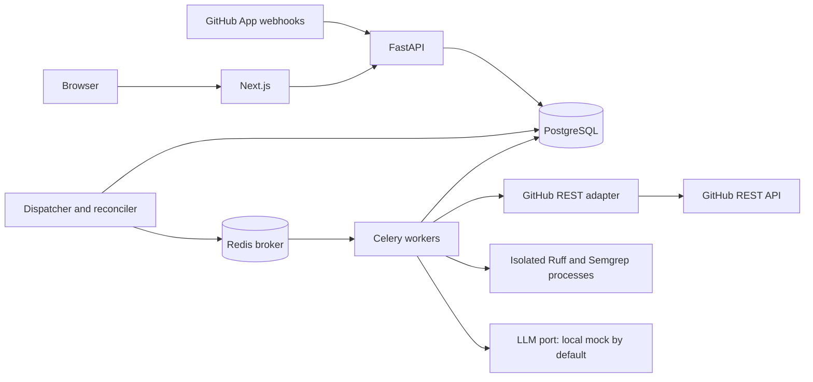

# Shrike architecture

Status: living architecture, 2026-11-06. Phase 2 persistence/read APIs and Phase 3 GitHub ingestion are implemented; the full review system below remains proposed. Product scope and limits live in [PRD.md](PRD.md); phase gates live in [ROADMAP.md](ROADMAP.md).

## Implemented Phase 2 baseline

The user explicitly redefined Phase 2 as persistence and core backend APIs. [ADR 0001](adr/0001-persistence-phase-scope.md) records the scope, naming/state decisions, security tradeoffs, and prerequisite setup. The implemented surface consists of a uv Python workspace, shared SQLAlchemy persistence package, FastAPI read API, six-table Alembic migration, synthetic CLI seed, database-only Compose service, and disposable PostgreSQL tests. It includes no live GitHub/LLM calls, webhook routes, worker pipeline, frontend, or cloud resources.

Current tables are `installations`, `repositories`, `pull_requests`, `review_jobs`, `review_findings`, and `review_executions`. Public job states are `pending`, `running`, `completed`, `failed`, and `canceled`. Composite foreign keys enforce job installation/repository/PR ownership, and unique analysis identities include both SHAs and policy digest. Execution attempts and finding fingerprints are unique within each job. Check constraints enforce IDs, enums, timestamps, line/path validity, and nonnegative usage. Internal worker identifiers and policy/fingerprint columns do not enter public read models.

Current routes are `/health/live`, `/health/ready`, `/v1/repositories`, `/v1/repositories/{id}`, `/v1/review-jobs`, `/v1/review-jobs/{id}`, and `/v1/review-jobs/{id}/findings`. List reads use bounded keyset pagination and filter/scope-bound cursors. `HistoryReader` is a framework-independent port; its SQLAlchemy adapter applies explicit paired installation/repository grants and active status checks to every resource query.

Real GitHub authentication remains deferred. Protected routes deny by default. Opt-in development bearer authentication uses server-configured paired stable GitHub IDs; it cannot be enabled in production. The synthetic seed is a guarded CLI, not an endpoint. The backend does not read `.env` automatically. See the [backend runbook](runbooks/backend-local.md) for setup, exact commands, constraints, and manual checks. Future workflow sections must be implemented against this baseline rather than assuming their provisional tables/states already exist.

## Implemented Phase 3 baseline

[ADR 0002](adr/0002-github-ingestion.md) records the user-requested GitHub integration scope. `POST /webhooks/github` is disabled by default; when enabled, it validates bounded raw bytes with constant-time HMAC-SHA256 before parsing. Strict schemas check event/header, App, installation, repository, PR, and SHA identities. New accepted receipts return `202` after commit; identical delivery replays return `200`; conflicting reuse returns `409`. Signed unsupported events/actions are recorded as ignored. No GitHub call happens in the acknowledgement path.

`webhook_deliveries` is a durable PostgreSQL inbox, with minimal routing JSON, body digest, processing state, safe reason, retry due time, attempt count, and expiring UUID lease. Raw payloads/signatures/source are not stored. `shrike_worker.ingest` polls this inbox independently, verifies canonical installation/App/account and repository/PR identity through `GitHubGateway`, and transactionally creates the uniquely identified pending job. It does not execute reviews. Redis/Celery dispatch remains a deferred transport step; the target diagram below is not the current deployment topology.

New installations remain inactive until verified. Installation access generations fence metadata fetched before revocation; expiring receipt tokens fence dead workers. One snapshot per installation is in flight at a time so concurrent workers cannot regress PR metadata. Suspension/deletion and repository-selection removal quarantine access immediately and cancel unfinished jobs. Canonical inventory re-enables only currently selected repositories. Deleted installation IDs cannot be resurrected by old events. Repository reassignment/reinstallation with existing history is quarantined because the Phase 2 composite ownership keys cannot be rewritten safely without a separate history design.

The read-only GitHub.com client uses short-lived RS256 App JWTs and bounded, in-memory installation-token caching. Repository tokens request only that repository ID and Metadata/Contents/Pull requests read permissions; inventory uses metadata-only access. Requests use a fixed origin and pinned API version, reject redirects and external pagination, bound JSON/diff/blob/file counts, verify immutable SHAs/blob hashes, and translate errors to safe codes. Rate-limit hints become durable retry schedules; transient HTTP attempts and processing attempts are capped separately. Raw error text, credentials, commit messages, diffs, and source never enter receipt/log storage.

Opened, reopened, synchronize, ready-for-review, and closed PR actions are supported. Canonical current state wins over webhook ordering. Draft/closed/archived and cross-repository/deleted-head fork PRs do not create jobs; fork support requires an explicit future design. Obsolete pending/running jobs are canceled when newer canonical revisions arrive. No static analysis, LLM calls, publication, real user login, or cloud work is included. Tests inject the GitHub port/HTTP transport and use synthetic payloads plus disposable PostgreSQL. [Manual App/tunnel setup](runbooks/github-app-manual.md) is separate and unperformed.

## Repository baseline

At the original planning inspection, one commit (`b4066e5`, `first commit`) tracked only a title-only `README.md`. A local untracked `.gitignore` contained `.env`; a local ignored `.env` existed and its contents were not read. There were no application files, manifests, migrations, tests, CI workflows, infrastructure files, or applicable ancestor `AGENTS.md` instructions. Phase 0 added planning documents and templates; Phase 2 subsequently added the backend baseline above.

## Proposed repository layout

This tree is a future layout, not a scaffolding instruction. Create directories only as their phase requires them.

```text
shrike/
  AGENTS.md
  README.md
  .env.example
  .gitignore
  compose.yaml
  pyproject.toml                   # shared Python workspace/tool configuration
  <python-lockfile>                # choose tooling in Phase 1
  apps/
    web/                          # Next.js App Router, React, TS, Tailwind
      src/app/
      src/components/
      src/lib/api/                # typed HTTP client; no backend credentials
      package.json
      <node-lockfile>
  services/
    api/
      src/shrike_api/             # FastAPI routes, auth, schemas, composition root
      alembic/versions/
      alembic.ini
      Dockerfile
    worker/
      src/shrike_worker/          # Celery app/tasks; dispatcher/reconciler CLI
      Dockerfile
  packages/
    backend/
      src/shrike/
        domain/                  # entities, state transitions, identities
        application/             # use cases and orchestration
        ports/                   # GitHub, LLM, persistence, queue, analyzer protocols
        adapters/
          github/                # REST and mock implementations
          llm/                   # mock first; hosted providers later
          persistence/           # SQLAlchemy mappings, repositories, unit of work
          queue/                 # Celery publisher
          analysis/              # Ruff/Semgrep, sandbox runner, diff mapping
        config.py
        telemetry.py             # safe logging/metrics; OTel later
      rules/semgrep/              # reviewed, pinned local rules
  tests/
    unit/
    integration/                 # PostgreSQL, Redis, scanner, adapter contracts
    e2e/                         # offline workflow and dashboard
    fixtures/                    # synthetic code, webhooks, diffs, model responses
  infra/
    docker/                      # runtime profiles and local bootstrap helpers
    terraform/                   # deferred until cloud phase
  docs/
    PRD.md
    ARCHITECTURE.md
    ROADMAP.md
    adr/                         # future decision changes
    runbooks/                    # future setup, recovery, retention, smoke tests
  .github/workflows/              # CI added in Phase 1 and expanded incrementally
```

Use one importable shared backend package and one database schema. Service directories contain process-specific entry points, not duplicated business logic. API owns the single Alembic migration history; all processes use it. Next.js consumes versioned API schemas, never database tables. Select simple workspace tooling in Phase 1 rather than introducing a build platform for this small monorepo.

## Runtime topology



The dispatcher is another command from the worker image, not a separate business service. It polls the outbox, recovers expired work, and schedules retention. PostgreSQL is authoritative. Redis contains only small ID-only messages; no source, tokens, or serialized domain objects. Disable the Celery result backend; persisted runs provide results.

Planned Compose services: `web`, `api`, `worker`, `dispatcher`, `postgres`, and `redis`. Only web/API ports bind to loopback by default. Database/broker ports remain private unless an explicit loopback development override is used. Persistent volumes hold database/broker data, never temporary analysis source. An ephemeral database is used for tests.

## Module boundaries and contracts

| Port | Domain-level responsibilities | Implementations |
| --- | --- | --- |
| `GitHubGateway` | Resolve installation/repository access, fetch canonical PR and bounded immutable content, publish/list Shrike reviews, validate user access. | GitHub REST; deterministic fake with timeout/rate-limit/ambiguous-write scenarios. |
| `LLMProvider` | Accept a bounded review context and return structured candidate findings, provider/model metadata, and usage; no tools or persistence. | Deterministic local mock; hosted adapters deferred. |
| `UnitOfWork` / repositories | Transactional receipts, runs, attempts, findings, leases, outbox, and publication intents. | SQLAlchemy/PostgreSQL; use real ephemeral PostgreSQL for transactional tests. |
| `JobPublisher` | Publish a versioned job kind plus opaque record ID. | Celery/Redis; in-memory test recorder. |
| `Analyzer` / `SandboxRunner` | Scan eligible files with trusted config and bounded execution; return typed results and coverage. | Ruff, Semgrep, isolated process runner; deterministic test adapters. |

Domain/application code must not import FastAPI, Celery, provider SDKs, or SQLAlchemy. Adapters translate exceptions into typed transient/permanent/authorization/rate-limit errors. FastAPI dependencies and worker entry points wire adapters. Use synchronous SQLAlchemy sessions and blocking workers initially; run DB-bound API handlers in FastAPI's threadpool rather than blocking the event loop. Async database I/O is a future optimization requiring evidence.

Use Pydantic for configuration and boundary validation. Share backend domain types within Python; expose an OpenAPI contract and generated or checked TypeScript client once endpoints stabilize. No hand-copied secrets or backend implementation in frontend types.

## Webhook request lifecycle

1. Accept `POST /webhooks/github` over HTTPS in deployed environments. Read a bounded raw body; enforce the 1 MiB application limit even without `Content-Length`.
2. Validate `X-Hub-Signature-256` with HMAC-SHA256 and constant-time comparison over the exact raw bytes, before parsing/trusting the event. Validate bounded delivery/event headers and a minimal event-specific schema. Never log the body or signature.
3. In one database transaction, insert a unique delivery receipt and a `process_delivery` outbox row for supported events. Keep only safe routing identifiers/action/revision hints, timestamp, and a body digest; do not store raw payloads or PR text. Treat hints as untrusted until canonical reconciliation.
4. Acknowledge only after commit: `202` for accepted work, `200` for a duplicate or ignored signed event, `401` for invalid/missing signature, `400` for malformed supported payload, `413` for oversize, `503` if persistence fails. Do not acknowledge an uncommitted job. Broker availability does not affect committed acceptance.
5. The dispatcher leases due outbox rows using database locking (`FOR UPDATE SKIP LOCKED` or equivalent). Publish `{schema_version, job_kind, record_id}` and mark dispatched only after broker confirmation. A crash between publish and marking causes safe duplicate delivery.
6. The delivery worker rechecks installation state and canonical PR metadata through the adapter. Persist installation/repository state, PR snapshot, unique review run, and its `review_run` outbox message transactionally. A lifecycle or close event reconciles canonical current state rather than trusting event order.

Drafts, closed PRs, unsupported actions, removed repositories, and inaccessible fork content have explicit skip/cancel reasons. Events for unknown installations trigger bounded canonical reconciliation; they cannot enable access solely through webhook claims. Removing an installation/repository immediately disables local access and queued publication; canonical verification before sensitive work covers delayed/missed events.

## Review job lifecycle

1. Consume an ID-only job. Validate schema and load the run from PostgreSQL. Duplicate tasks for terminal or actively leased work exit safely. Acquire a repository concurrency claim and run lease with a monotonically increasing fencing token; create an attempt row. Use short transactions, not database locks held during network/scanner operations.
2. Verify installation access and canonical PR base/head SHA and open/non-draft status. If the run is obsolete, mark it `superseded` or `canceled`. Never use a branch name as an immutable content identity.
3. Fetch a bounded diff and file listing with explicit pagination/completeness checks. Fetch eligible changed Python files at the PR head SHA and, only when needed for mapping, base SHA. For forks, use the canonical PR head repository/commit through permitted GitHub API access; do not assume the base repository owns the head blob.
4. Avoid cloning/checking out the repository. Parse diff hunks, normalize paths, reject absolute/traversal/NUL paths, symlinks, submodules, binaries, unsafe encodings, and unsupported files. Store source in a private per-attempt temporary directory; enforce byte/file/line limits before analysis.
5. Run Ruff and Semgrep with a fixed reviewed rule set and no repository configuration. Scan bounded whole changed files for context, then map findings to changed new-side lines. Both required analyzers must succeed for normal publication. An analyzer timeout/tool error is a failed attempt, not zero findings.
6. Build a bounded prompt from eligible diff/file context only. Call the mock LLM through the provider port; validate a strict schema and normalize candidates. The model cannot choose tools, network locations, analyzer rules, policy, or publication targets. Malformed/timeout output yields a disclosed static-only result; do not repeatedly call a paid provider to repair arbitrary output.
7. Normalize severity (`info`, `low`, `medium`, `high`, `critical`), source, rule/category, repository-relative path, head line range, explanation, and optional suggestion text. Confirm path/line existence and changed-line membership before inline publication. Use explicit rule/category mappings plus path/line identity to merge equivalent cross-source issues; retain provenance. Do not use another LLM for deduplication.
8. Persist capped findings and coverage in one fenced transaction; retain tool, ruleset, prompt, provider/model, and policy versions. Discard raw prompts/responses and delete temporary source in `finally`; a janitor removes abandoned directories after crashes.
9. Create a publication intent from persisted results. Recheck current installation/PR state immediately before posting, then publish/reconcile as below. Analysis completion and publication success are separate states.

If the diff is truncated or cannot be mapped reliably, skip the run with a reason instead of producing clean feedback. File-count caps produce a partial result with exact coverage. Deleted/old-side lines are excluded from inline comments in the MVP. Stable lexical path order and severity/path/line/rule ordering make truncation and comment selection deterministic.

## Identity, retries, and publication

Webhook identity is the GitHub delivery ID. Analysis identity is `(repository_id, pr_number, base_sha, head_sha, policy_digest)`. The digest includes analyzer/rule versions, prompt version, provider/model identity, filters, and relevant limits; ordinary re-delivery does not create a new run. Both SHAs are included because base changes can change review coverage without a new head commit. PR `edited` schedules analysis only when the canonical base identity changes.

The implemented job states are `pending`, `running`, `completed`, `failed`, and `canceled`. Ingestion creates/cancels jobs; there is no user-facing mutation endpoint or review executor yet. Future review dispatch will map queued/retry-wait work onto this contract, with dedicated scheduling/outcome fields or a justified migration for skipped/superseded/degraded results. The review worker must fence state changes, and publication will have its own state. Current ingestion receipts already have their own attempt/retry/lease state; this does not implement review execution scheduling.

The database dispatcher owns scheduling and bounded exponential backoff with jitter. Use at most three processing attempts; do not layer independent Celery autoretry loops over this policy. Honor bounded GitHub retry/reset hints. Celery uses late acknowledgement, bounded visibility timeout, low prefetch, JSON-only serialization, and task time limits longer than the application deadline/lease window. Heartbeats renew leases; recovery invalidates expired owners. A periodic reconciler republishes dispatched-but-unclaimed jobs after a timeout, so lost Redis data does not lose PostgreSQL work.

Publication state: `pending -> inflight -> published | uncertain | failed | suppressed`. Persist a deterministic marker (`run UUID + revision`) and payload digest before the API call. Use one advisory review (`COMMENT`), with a bounded summary and up to ten new-side inline comments. Include a coverage/disclaimer label and a stable hidden marker in the summary. The mock is labeled as mock-assisted, not real AI analysis.

Before any retry, list existing reviews by this App identity and marker with bounded, complete pagination. If found, save the GitHub review ID. A definite non-write failure may retry up to three safe publication attempts. A lost response/timeout after a possible write becomes `uncertain`; reconciliation may confirm success, but must not blindly re-post. After 24 hours without a conclusive answer, retain `uncertain` and document manual investigation. Analysis is not rerun merely because publication is uncertain.

GitHub does not participate in the database transaction. There remains a small race between checking the PR revision/lease and the external write. Attach the exact head commit ID, minimize the window, check afterward, and mark any detected late publication as stale; do not claim atomic cancellation or exactly-once external effects. Never automatically delete/edit a historical review to hide this race.

## Initial data model

Use internal UUID primary keys and UTC `timestamptz` timestamps unless stated otherwise. GitHub IDs are unique `BIGINT` external identifiers, not usernames. Use foreign keys, explicit unique constraints, bounded text/JSON, and check constraints for valid states; migrations are the authority. JSON is for small versioned metadata, not arbitrary payload archives.

| Table | Core fields and constraints |
| --- | --- |
| `users` | `id`, unique `github_user_id`, display login, created/updated timestamps. Login is display data, not authorization. |
| `user_credentials` | Unique `user_id`, encrypted user/refresh token if supplied, expiry, key version. No plaintext tokens; delete on revocation/logout as policy requires. |
| `sessions` | Unique hash of opaque session token, `user_id`, expiry, revoked timestamp, CSRF binding. Never store the browser bearer token in plaintext. |
| `installations` | Unique `github_installation_id`, account ID/type, status (`active`, `suspended`, `deleted`), canonical verification time. Tombstones prevent out-of-order restoration. |
| `repositories` | Unique `github_repository_id`, current installation FK, owner/name display data, private flag, access status, canonical verification time. Preserve disabled metadata for history. |
| `pull_requests` | Repository FK, number, optional external PR ID, base/head SHA, open/draft state, last verified time; unique `(repository_id, number)`. Do not store titles/bodies by default. |
| `webhook_deliveries` | Unique delivery ID, event/action, external routing IDs, digest, minimal revision hints, processing state/reason, received/processed timestamps. No raw body. |
| `review_jobs` | Implemented: PR/repository/installation ownership, base/head SHA, policy digest, explicit state, created/started/finished timestamps, unique analysis identity. Future: coverage, scheduling, lease/fence, outcome reason. |
| `review_executions` | Implemented: job FK, attempt, state, timestamps, duration, safe error code, analyzer/ruleset/prompt/provider/model versions, token usage, internal worker identifier; unique `(job_id, attempt)`. Future: stage/fence. No raw tool/model output. |
| `review_findings` | Implemented: job FK, fingerprint, source, rule, severity, relative path, line range, bounded message; unique `(job_id, fingerprint)`. Future: richer provenance/category, suggestions, inline eligibility. Treat content as private. |
| `publications` | Unique run FK, deterministic marker, payload digest, state, GitHub review ID, safe retry count/error code, last checked time, lease/fence. At most one intent per run. |
| `outbox_messages` | Kind, aggregate ID, schema version, dispatch generation, due time, lease, status, publish count; unique `(kind, aggregate_id, generation)`. ID-only payloads. |

Enforce one active review per repository through a database-backed expiring claim (a dedicated claim row keyed by repository, or equivalent atomic conditional update). Publication has its own lease so a duplicate delivery cannot initiate a second concurrent write. Long-running work does not hold an open SQL transaction. Cross-table repository/installation ownership must be checked by the use case and tested; a foreign key alone is insufficient.

Indexes: repository/PR run history by creation time; run state/retry time/lease expiry; pending outbox due time; installation/repository access status; findings `(run_id, severity)`; session expiry. Paginate history with stable keyset cursors. Compute initial metrics from authorized run/attempt rows; no separate metrics warehouse or precomputed tenant aggregates.

Retention purges findings/publication content with expired runs after 30 days; metadata needed by active jobs is not deleted prematurely. Reduce expired run/publication rows to content-free tombstones containing the analysis identity, terminal state, marker, and external review ID; retain these for deployment lifetime so content expiry does not allow duplicate historical reviews. An explicit full erasure/reset must document that deduplication history is lost. Delivery receipts expire after seven days only once downstream work is terminal; retained run identities protect later replay. On repository removal/uninstall, revoke access immediately and purge repository-derived content within 24 hours; keep only minimal identity/status tombstones. Tombstones are still access-controlled metadata. Backups must obey a documented expiry schedule before hosted operation. GitHub-posted feedback remains on GitHub under its own lifecycle.

## Dashboard authentication and authorization

Use GitHub App user authorization (OAuth web flow) through backend endpoints. Validate one-time expiring state; use PKCE if supported by the selected flow/library. Exchange credentials server-side. Encrypt stored tokens with a key outside PostgreSQL, record key versions, support expiry/refresh/revocation, and never expose tokens to Next.js/browser JavaScript.

Issue an opaque HttpOnly, SameSite=Lax session cookie; Secure in deployed HTTPS environments, with explicit localhost-only development handling. Use a same-origin `/api` proxy in Next.js to avoid browser token storage and broad CORS. Backend owns auth. Explicitly allowlist callbacks/origins, block open redirects, require CSRF protection/Origin checks on state-changing session endpoints, and clear/revoke sessions on logout. Initial session lifetime: eight hours; access-cache lifetime: at most 60 seconds.

Authorize every repository list, run, finding, and metrics query using the intersection of active App installation repositories and repositories the authenticated GitHub user can currently access via the user-token adapter. Never infer access from organization name, URL parameter, installation ownership claim, or possession of a run UUID. Cache short-lived access decisions server-side and invalidate on revocation/removal. On expired credentials or failed verification without a fresh cache entry, deny access. Known removal overrides a cached grant immediately; missed revocation is bounded by the cache TTL. Local mock identities exist only in explicit local/test mode and cannot be enabled in production configuration.

Planned routes include `GET /health/live`, `GET /health/ready`, auth login/callback/logout, `GET /v1/repositories`, `GET /v1/review-runs`, `GET /v1/review-runs/{id}`, `GET /v1/review-runs/{id}/findings`, and `GET /v1/metrics`. These are design contracts, not implemented endpoints. Use safe error envelopes and repository-scoped cursor/filter validation; return non-revealing responses for inaccessible resources.

## Security boundaries and threat model

Assets include App/user credentials, private source, findings, authorized review history, PostgreSQL integrity, and GitHub write authority. Attackers include anonymous webhook callers, malicious PR authors (including forks), unauthorized dashboard users, and compromised dependencies/model responses. Assume source and model output are hostile. Host/database administrator compromise is outside the app boundary but informs secret and backup handling.

| Boundary / threat | Required controls and evidence |
| --- | --- |
| Internet -> webhook: forgery, replay, flooding | Raw-body HMAC, bounded parsing, delivery uniqueness, rate/body limits at deployment edge and app, safe error output. Test missing/wrong signatures, replays, oversize/chunked bodies, DB outage. |
| Webhook -> installation state: reordered revocation | Canonical verification, disabled tombstones, no event-only restoration, checks before fetch/publish. Test stale lifecycle events. |
| Browser -> API: IDOR, CSRF, XSS | Repository-scoped queries, opaque cookie sessions, OAuth state, CSRF/Origin checks, escaped text, safe Markdown rendering with no raw HTML or unsafe links, CSP. Test cross-repo IDs and malicious finding text. |
| GitHub responses -> filesystem: traversal, malicious paths/content, SSRF | Only fixed GitHub adapter endpoints/allowed hosts; no arbitrary payload URLs or unrestricted redirects. Bound pagination/downloads, verify SHA/type, reject symlinks/traversal. Test fork/rename/truncated/binary cases. |
| Source -> scanner: parser exploit/resource exhaustion | No shell or repo execution/config; pinned trusted tools/rules; isolated non-root process, explicit filesystem mounts, no network, scrubbed environment, process/CPU/memory/time/output limits. Test forbidden filesystem/network access and kill/cleanup behavior. |
| Source/model -> LLM/output: injection and exfiltration | Mock default, no tools, minimal bounded context, structured output validation, fixed publication target, private-code egress opt-in. Test instructions embedded in code and malicious responses. |
| Queue -> worker: forged/pickled jobs, duplicates | Private authenticated broker, JSON-only ID messages, schema validation, DB ownership/state checks, fenced leases. Test duplicate/stale jobs and broker data loss. |
| Worker -> GitHub: excessive privilege/duplicate write | Least-privilege App tokens, current-access/revision check, one publication intent, marker reconciliation, capped comments. Test lost responses and revocation. |
| Storage/logs -> operator: leaks and over-retention | Encrypt user credentials, secret redaction, no source/prompt logging, access-scoped findings, retention janitor, restricted backups. Capture logs in tests and assert synthetic secret/code sentinels are absent. |

Scanner isolation is required even though scanners do not intentionally execute Python. Phase 3 must prove an OS-level Linux sandbox (initial candidate: a namespace/filesystem sandbox such as bubblewrap with resource limits) inside the supported worker container. It must expose only trusted tool/runtime files, read-only eligible input, and a private scratch directory; exclude host/service credentials and network. A sanitized environment alone is insufficient. No Docker socket, privileged container, or broad host mount is permitted. If the candidate is incompatible with Docker Desktop's security profile, stop analyzer delivery, record an ADR for a viable restricted runner, and retain fail-closed behavior. Do not add a scanner microservice by default.

Current App permissions: Metadata read, Contents read, and Pull requests read. Pull requests write is deferred until publishing is implemented and explicitly enabled. Subscribe to Pull request events; GitHub delivers relevant installation events automatically. User authorization will be for dashboard access, not broad write access. Current permission requirements and manual setup are documented in the GitHub runbook using official sources. Installation tokens are narrowed to target repositories and cached only in memory until shortly before expiry. Never store App JWTs/tokens in jobs/browser state. Keep the configured PEM outside the checkout with restricted read access; container secret mounting and cloud secret management remain future work. Disable debug errors and SQL parameter logging on sensitive paths.

## Local development, checks, and observability

Phase 1 establishes pinned runtimes, Python packaging, Node package manager, Compose networking, migrations, configuration validation, and exact commands. Placeholder values are rejected when a setting is required; mock mode must not require GitHub/provider credentials. Production must reject mock identity bypass, development cookies, wildcard origins, and missing secrets.

Planned checks: Ruff lint/format, Python type checking, pytest, migration upgrade/schema checks, TypeScript checks/lint, Next.js production build, React/component tests where behavior warrants them, and Playwright offline workflow tests. Integration tests use real ephemeral PostgreSQL/Redis and trusted scanner binaries with fake GitHub/LLM ports; never analyze a live private repository in CI. CI will pin actions/dependencies, use minimum workflow permissions, and not expose secrets or write tokens to untrusted PR code (`pull_request_target` checkout execution is prohibited).

Log only structured identifiers and safe metadata: request/delivery/run/attempt IDs, numeric installation/repository IDs, stage, outcome code, duration, counts, and usage. Do not log repository names/paths, source, raw exceptions containing bodies, prompts, responses, auth headers, or SQL values. Expose internal backlog age, queue wait, durations, failures/retries, publication uncertainty, skips, and token usage without high-cardinality source labels. Dashboard product metrics remain authorized HTTP resources; internal metrics are not publicly exposed.

Liveness checks process health; API readiness verifies required database/schema state, not GitHub availability or Redis (durable ingestion can continue without Redis). Worker/dispatcher health reports broker connectivity, heartbeat, lease age, and backlog. Document local restart, retry exhaustion, uncertain publication investigation, retention, backup/restore, and migration procedures in the hardening phase. OpenTelemetry instrumentation/export and cloud monitoring are later work.

## Decisions and tradeoffs

| Decision | Rationale and cost |
| --- | --- |
| Modular monolith + worker | Shared invariants and one migration history; independent worker scaling. Requires disciplined imports/interfaces rather than network boundaries. |
| PostgreSQL outbox + Celery/Redis | Closes the DB/broker dual-write gap and recovers broker loss. Adds a dispatcher/reconciler and lease tests; does not promise exactly-once delivery. |
| Immutable base/head identities | Prevents stale/fork confusion and deduplicates retries; metadata changes can supersede pending work. Fetching exact snapshots adds API calls. |
| Static-first, optional LLM | Useful deterministic findings and offline tests. Mock validates orchestration only; model quality and provider cost remain unproven. |
| Data-only, changed-file scanning | No builds/dependency execution and bounded cost. Misses cross-file/runtime issues and findings outside changed lines. |
| One advisory review | Reduces API writes/noise and simplifies recovery. Some findings remain dashboard-only; ambiguous writes still require reconciliation. |
| GitHub-based repository authorization | Avoids inventing role management. Adds OAuth/refresh handling, GitHub dependency, and a bounded revocation-cache window. |
| Linux worker isolation | Protects credentials/host from parser bugs. Adds an early portability gate; native Windows scanner workers are deferred. |
| Cloud/OTel later | Preserves focus on a reproducible local workflow. Production readiness, availability, and cost claims remain deferred until measured. |

Future architectural changes should be captured as small ADRs with evidence, alternatives, consequences, and migration impact; update this document and the roadmap together.
